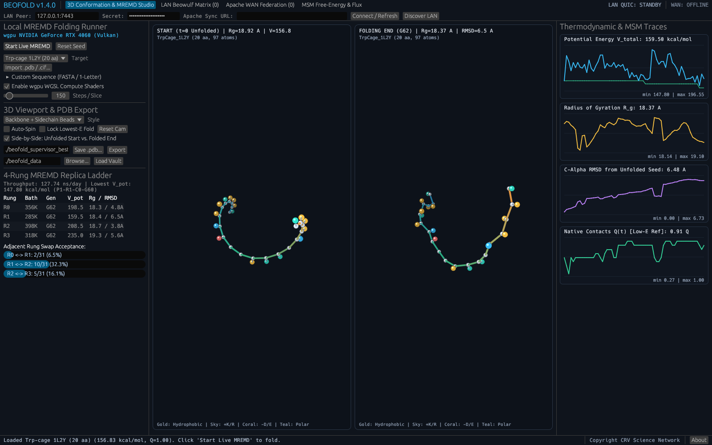

# BeoFold (`v1.4.0`) — Pure-Rust Distributed Beowulf & Multi-Cluster Protein Folding Engine



BeoFold is a 100% pure-Rust distributed molecular dynamics, protein structure folding, and Markov State Model (`MSM`) kinetic analysis platform built for heterogeneous Windows and Linux home Beowulf clusters, desktop supervisor visualization, and Apache HTTP multi-cluster WAN federation.

## Workspace Crate Architecture

| Crate | Binary / Library | Responsibility |
| :--- | :--- | :--- |
| `crates/fold-proto` | Library | [Folding@home `PRCG`](https://foldingathome.org/science/folding) (`Project, Run, Clone, Generation`) coordinates, [`rkyv`](https://crates.io/crates/rkyv) zero-copy frames, [`lz4_flex`](https://crates.io/crates/lz4_flex/0.14.0) compression, [`blake3`](https://crates.io/crates/blake3) LAN MACs, and [`ed25519-dalek`](https://crates.io/crates/ed25519-dalek) work-unit & HTTP request signing. |
| `crates/fold-physics` | Library | [`pdbtbx`](https://docs.rs/pdbtbx) PDB/mmCIF parser, harmonic covalent bonds/angles, singularity-free Blondel-Karplus torsions, `C^1` force-shifted 12-6 Lennard-Jones + Generalized-Born screened Coulomb + EEF1 Gaussian hydrophobic solvation, 3D Morton Z-order [`rayon`](https://crates.io/crates/rayon) CPU neighbor lists, cross-vendor [`wgpu`](https://docs.rs/crate/wgpu/latest) WGSL GPU compute shaders (`nonbonded.wgsl`), symmetric Langevin `BAOAB` integrator, [MREMD](https://pmc.ncbi.nlm.nih.gov/articles/PMC1302658/) Metropolis swapper, and 4-gate biophysical sanity verification. |
| `crates/fold-storage` | Library | Crash-safe [`redb`](https://crates.io/crates/redb) ACID MVCC ledger + atomic content-addressed `blobs/<2-hex>/<blake3>.lz4` store, Raft follower replication, `quorum = 1 | 2` cross-cluster consensus, and deterministic 20-step canary spot-checks. |
| `crates/fold-node` | `fold-node` (CLI) | Headless Windows/Linux compute worker & Beowulf LAN cluster node featuring [`mdns-sd`](https://crates.io/crates/mdns-sd) `_beofold._udp.local.` auto-discovery, `/24` unicast firewall fallback, Ongaro-Ousterhout Raft leader election, [`quinn`](https://crates.io/crates/quinn) + [`rustls`](https://crates.io/crates/rustls) TLS 1.3 transport, `SIGINT`/`SIGTERM` graceful checkpoint flushing, `--auto-throttle`, and [`reqwest`](https://crates.io/crates/reqwest) outbound Apache WAN synchronization. |
| `crates/fold-sync` | `fold-sync` (Web) | Dual-mode web synchronizing server supporting persistent [`axum`](https://crates.io/crates/axum) daemon mode behind [Apache `mod_proxy_http`](https://httpd.apache.org/docs/current/mod/mod_proxy_http.html) and zero-daemon RFC-3875 [Apache `mod_cgid`](https://httpd.apache.org/docs/current/mod/mod_cgid.html) CGI execution (`GATEWAY_INTERFACE=CGI/1.1` auto-detected), plus a read-only public HTML5 Canvas 3D conformation viewer & multi-cluster leaderboard at `/beofold/dashboard`. |
| `crates/fold-gui` | `fold-gui` (GUI) | 4-tab Desktop Supervisor Workstation built on [`eframe`](https://crates.io/crates/eframe) and [`egui`](https://crates.io/crates/egui): (1) Live 3D Conformation & MREMD Studio, (2) LAN Beowulf Cluster Matrix, (3) Global Apache WAN Federation, and (4) Interactive `fold-msm` 2D `(RMSD, R_g)` Free-Energy Surface & Markov Flux Network where clicking any PCCA+ macrostate or microstate loads its 3D conformation. |
| `crates/fold-msm` | `fold-msm` (CLI + Lib) | `#![forbid(unsafe_code)]` Markov State Model engine implementing parallel Horn/Kabsch C-alpha RMSD `k`-medoids clustering, [Prinz-Noé reversible detailed-balance MLE](https://pubs.aip.org/aip/jcp/article/134/17/174105/699460/Markov-models-of-molecular-kinetics-Generation-and), pure-Rust Cyclic Jacobi eigendecomposition, Transition Path Theory (`p_fold` committor), [PCCA+ metastable macrostate coarse-Graining](https://www.mdpi.com/2079-3197/6/1/20), 2D `(RMSD, R_g)` free-energy landscapes (`SVG`/`CSV`/`JSON`), and representative macrostate `.pdb` export. |

## Quick-Start Commands

### 1. Build & Run Physics / Cryptography / GPU / MSM / Sync Tests
```bash
cargo build --workspace --release
cargo test --workspace --release
```

### 2. Launch `fold-sync` & Open the Public Read-Only Browser Observatory
```bash
cargo run --release -p fold-sync -- serve --bind 127.0.0.1:8780 --init-trpcage
```
Open `http://127.0.0.1:8780/beofold/dashboard` (or `https://yourdomain.com/beofold/dashboard` behind [Apache `mod_proxy_http`](https://httpd.apache.org/docs/current/mod/mod_proxy_http.html) or [Apache `mod_cgid`](https://httpd.apache.org/docs/current/mod/mod_cgid.html)) to inspect live federated Beowulf cluster leaderboards, PRCG/MREMD energetics, the interactive HTML5 Canvas 3D conformation viewer, and one-click crystallographic `.pdb` downloads (`/beofold/api/v1/public/conformation/best.pdb`). All write and lease endpoints remain strictly protected by `Ed25519` request authentication.

### 3. Launch the 4-Tab Supervisor Workstation (`fold-gui`)
```bash
cargo run --release -p fold-gui -- \
  --lan-peer 127.0.0.1:7443 \
  --cluster-secret "my-home-beowulf-key" \
  --sync-url "https://yourdomain.com/beofold/api/v1"
```

### 4. Headless Markov State Model CLI (`fold-msm`)
```bash
cargo run --release -p fold-msm -- demo-analyze --out-dir ./msm_demo_out
```

### 5. Unattended Boot Service Installation (`deploy/systemd/` & `deploy/windows/`)
```bash
sudo ./deploy/systemd/install-linux-systemd.sh --role node --cluster-secret "my-home-beowulf-key" --open-firewall
```
```powershell
.\deploy\windows\Install-BeoFoldNode.ps1 -ClusterSecret "my-home-beowulf-key" -AutoThrottle
```

## Citation & CRV Science Apps Hub

- **CRV Science Apps Hub**: <https://crvscience.com/apps>
- **Companion Preprint (`APP-PREPRINT-02`)**: [BeoFold: Distributed Langevin Molecular Dynamics, Replica-Exchange Sampling, and Markov State Kinetic Modeling](https://crvscience.com/apps/preprints/beofold-distributed-protein-msm)
- **Zenodo Concept DOI**: [10.5281/zenodo.24222370](https://doi.org/10.5281/zenodo.24222370)
- **Validation Suite & Telemetry**: [`validation/README.md`](validation/README.md) (`cargo test --workspace`)
- **Machine-Readable Metadata**: [`CITATION.cff`](CITATION.cff)

```bibtex
@article{White2026BeoFold,
  author  = {White, Bryan P.},
  title   = {BeoFold: Simulating How Proteins Fold Using Distributed Computing and State Networks},
  journal = {CRV Science Apps Preprints},
  year    = {2026},
  doi     = {10.5281/zenodo.24222370},
  url     = {https://crvscience.com/apps/preprints/beofold-distributed-protein-msm},
  note    = {Software v1.4.0; Preprint ID: APP-PREPRINT-02}
}
```
